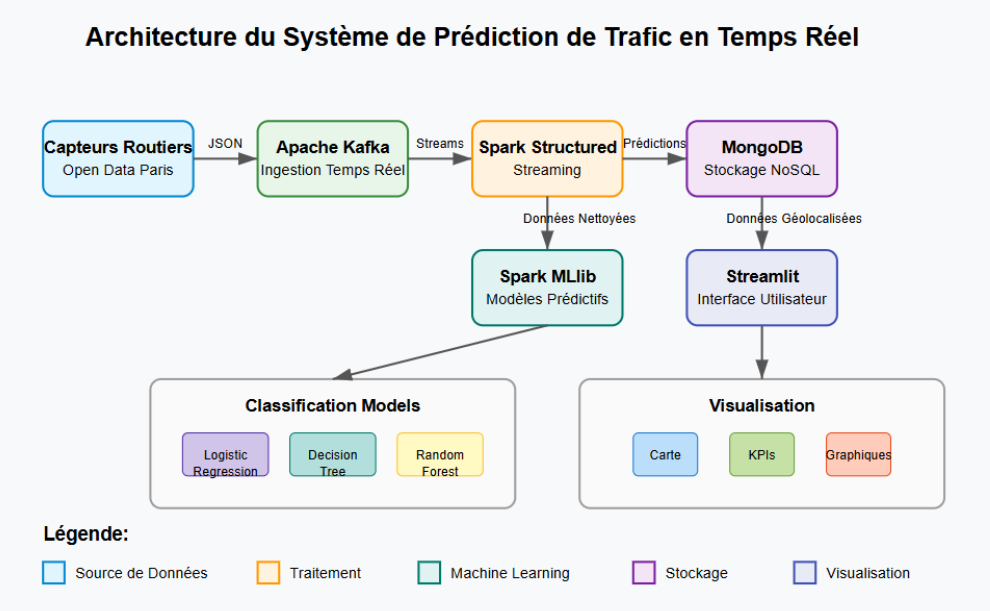
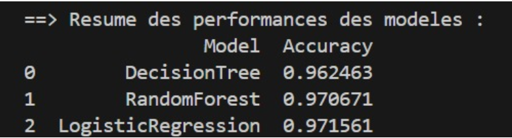
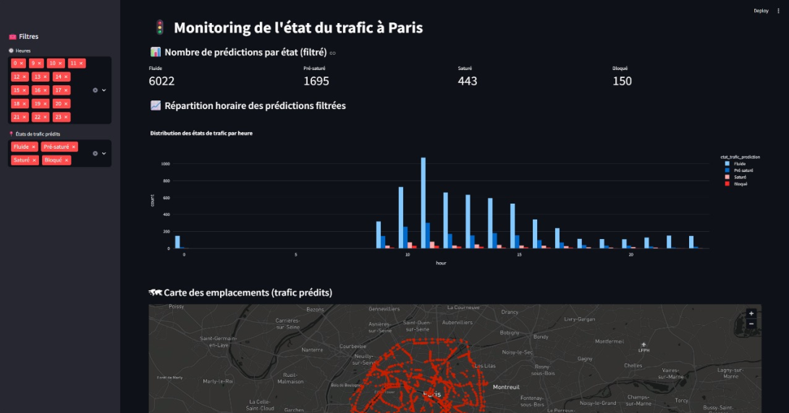
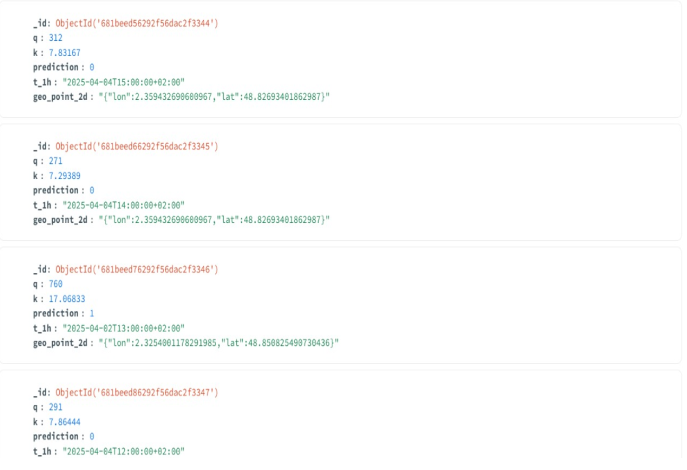

# Real-Time Paris Traffic State Prediction

**A Big Data & Artificial Intelligence project focused on real-time urban traffic monitoring and machine learning-based prediction.**

An end-to-end streaming pipeline that processes Paris road traffic sensor data, predicts traffic conditions using Apache Spark ML, and visualizes real-time insights through an interactive Streamlit dashboard.

Academic project — National School of Applied Sciences (ENSA), Big Data & AI.

**Authors:** Abdessamad Ait Brahim · Ayyoub Amazal  
**Supervisor:** Dr. Imad Sassi

---

<div align="center">

[](#overview)
[](#system-architecture)
[](#dataset)
[](#real-time-streaming-pipeline)
[](#machine-learning-approach)
[](#model-evaluation-and-results)
[](#interactive-dashboard)
[](#installation-and-execution)
[](#project-documentation)
[](#contributors)

</div>

---

## Overview

Urban traffic congestion is one of the major challenges facing modern cities. Monitoring road conditions and anticipating traffic changes can help improve urban mobility and support better transportation decisions.

This project implements a **real-time traffic prediction system** using Big Data technologies and Machine Learning.

The system collects traffic sensor data from Paris, processes incoming JSON messages through a distributed streaming architecture, predicts traffic conditions, and stores the results for visualization.

### Main objectives

- Build a real-time data ingestion pipeline using Apache Kafka.
- Process and transform streaming data using Spark Structured Streaming.
- Train and compare multiple Machine Learning classification algorithms.
- Predict road traffic conditions using flow and density measurements.
- Store real-time predictions in MongoDB.
- Develop an interactive dashboard to monitor traffic conditions across Paris.

## Dataset

**Source:** [Open Data Paris](https://opendata.paris.fr/)

The project uses Paris road traffic sensor data containing measurements and geographical information.

### Main attributes

| Attribute | Description |
|---|---|
| `q` | Traffic flow |
| `k` | Traffic density |
| `etat_trafic` | Traffic state (prediction target) |
| Geolocation | Geographic coordinates of traffic sensors |
| Timestamp | Date and time associated with measurements |

**Dataset file:** `data/data.json`

The JSON data is used as the input source for the streaming pipeline.

> **Large file notice:** The dataset is approximately 656 MB. Git LFS is required to store and version this file on GitHub. Configure Git LFS before cloning or pushing the repository.

## System Architecture

The project follows a distributed architecture combining real-time data ingestion, stream processing, machine learning, database storage and interactive visualization.

### Architecture diagram



### Technology stack

| Technology | Responsibility |
|---|---|
| **Apache Kafka** | Real-time ingestion and message distribution |
| **Apache Spark** | Distributed data processing |
| **Spark Structured Streaming** | Reads and processes incoming Kafka messages |
| **Spark ML** | Model training and traffic state classification |
| **MongoDB** | Storage of real-time predictions |
| **Streamlit** | Interactive visualization and monitoring |
| **Docker Compose** | Deployment of infrastructure services |
| **Python** | Pipeline implementation and integration |

### Data flow

1. Traffic sensor data is read from the JSON source.
2. Kafka receives and distributes traffic messages at approximately one message per second.
3. Spark Structured Streaming consumes messages from Kafka.
4. Incoming JSON data is parsed, cleaned and transformed.
5. The trained Spark ML model predicts the corresponding traffic state.
6. Predictions are stored in MongoDB.
7. Streamlit retrieves the results and displays real-time traffic insights.

## Real-Time Streaming Pipeline

The streaming component is responsible for continuously processing traffic sensor measurements.

### Processing stages

- **Data ingestion:** Kafka receives incoming JSON messages.
- **Data extraction:** Spark reads messages from the Kafka topic.
- **Data transformation:** JSON parsing, data cleaning and feature preparation.
- **Prediction:** The trained Logistic Regression PipelineModel classifies traffic conditions.
- **Data persistence:** MongoDB stores the generated predictions.

The pipeline connects distributed streaming processing with the trained machine learning model to provide continuously updated traffic information.

## Machine Learning Approach

The machine learning component focuses on predicting traffic conditions using two main input features.

### Features and target

| Type | Variable | Description |
|---|---|---|
| Input | `q` | Traffic flow |
| Input | `k` | Traffic density |
| Target | `etat_trafic` | Traffic state |

### Models compared

Three classification algorithms were trained and evaluated using Spark ML:

| Algorithm | Description |
|---|---|
| Logistic Regression | Linear classification algorithm |
| Decision Tree | Tree-based classification algorithm |
| Random Forest | Ensemble learning algorithm combining multiple decision trees |

### Training methodology

- Train/test split: 80% training and 20% testing.
- Feature preparation using Spark ML.
- Model training and comparison.
- Evaluation using classification metrics.
- Selection of the best-performing model.

### Evaluation metrics

The models are evaluated using:

- Accuracy
- Weighted Precision
- Weighted Recall
- Weighted F1-score

### Best-performing model

**Logistic Regression** was selected as the best-performing model in the project.

The complete trained model is saved as a Spark `PipelineModel`, including:

- StringIndexer
- VectorAssembler
- Logistic Regression classifier

This allows the same preprocessing and prediction pipeline to be reused during real-time streaming.

## Model Evaluation and Results

The project compares the three trained classification models to identify the most suitable algorithm for traffic state prediction.



The evaluation considers both predictive performance and suitability for integration into the streaming architecture.

**Selected model:** Logistic Regression.

The saved PipelineModel is subsequently loaded by the Spark prediction application to classify incoming traffic measurements.

## Interactive Dashboard

The project includes a Streamlit dashboard designed to provide an interactive overview of Paris traffic conditions.



### Dashboard features

- **Traffic state monitoring:** Displays prediction counts for each traffic condition.
- **Hourly analysis:** Visualizes traffic distribution and evolution over time.
- **Interactive geographical map:** Displays traffic sensor locations across Paris.
- **Prediction explorer:** Provides a filterable table of prediction records.
- **CSV export:** Allows users to export filtered prediction data.
- **Automatic refresh:** Updates dashboard information every 60 seconds.

### MongoDB Integration

MongoDB is used as the persistence layer for storing streaming predictions.



The database allows the dashboard to retrieve prediction records and analyze traffic conditions over time.

## Installation and Execution

### Prerequisites

Make sure the following tools are installed:

- Docker and Docker Compose
- Java 8 or Java 11
- Python 3.8 or lower (for the project's PySpark 3.0.0 environment)
- Git and Git LFS
- GitHub account (for repository access)

**Windows users:** Depending on the environment, Spark may also require `HADOOP_HOME` configured with `winutils.exe`.

### 1. Clone the repository

```bash
git clone https://github.com/abdessamadaitbrahim/real-time-Paris-traffic-prediction.git

cd real-time-Paris-traffic-prediction
```

### 2. Set up the Python environment

```bash
python -m venv .venv

# Windows Git Bash
source .venv/Scripts/activate

# Linux / macOS
source .venv/bin/activate

pip install -r requirements.txt
```

### 3. Start the infrastructure

Launch Kafka, Zookeeper and MongoDB:

```bash
docker compose up -d
```

### 4. Train the Machine Learning models

Execute the training script:

```bash
python src/train_models.py
```

This step trains and compares the three classifiers and creates the selected model:

```text
models/best_model_logisticregression/
```

### 5. Start the Spark prediction pipeline

Open a new terminal:

```bash
python src/spark_predictor.py
```

Keep this process running to consume Kafka messages and generate predictions.

### 6. Start the Kafka producer

Open another terminal:

```bash
python src/kafka_producer.py
```

This script sends traffic data to Kafka for real-time processing.

### 7. Launch the Streamlit dashboard

Open another terminal:

```bash
streamlit run src/streamlit_app.py
```

The dashboard will be available at:

```text
http://localhost:8501
```

## Project Structure

```text
real-time-Paris-traffic-prediction/
│
├── data/
│   └── data.json
│
├── docs/
│   ├── images/
│   │   ├── architecture.png
│   │   ├── model_comparison.png
│   │   ├── mongodb_compass.png
│   │   └── dashboard.png
│   ├── presentation_big_data.pptx
│   └── rapport_final_big_data.pdf
│
├── models/
│   └── best_model_logisticregression/
│
├── src/
│   ├── train_models.py
│   ├── spark_predictor.py
│   ├── kafka_producer.py
│   └── streamlit_app.py
│
├── requirements.txt
├── docker-compose.yml
└── README.md
```

## Project Documentation

Additional project materials are available in the `docs/` directory:

- [Project Presentation (PowerPoint)](docs/presentation_big_data.pptx)
- [Final Academic Report (PDF)](docs/rapport_final_big_data.pdf)

## Contributors

This project was developed as part of the Big Data & Artificial Intelligence academic program at ENSA.

| Contributor | Role |
|---|---|
| **Abdessamad Ait Brahim** | Project contributor |
| **Ayyoub Amazal** | Project contributor |

**Academic Supervisor:** Dr. Imad Sassi

---

## Acknowledgments

Special thanks to our academic supervisor, **Dr. Imad Sassi**, for his guidance throughout this project.

We also acknowledge [Open Data Paris](https://opendata.paris.fr/) for providing the traffic data used in this work.

---

<div align="center">

**Real-Time Paris Traffic State Prediction**

*Big Data · Artificial Intelligence · Real-Time Streaming · Machine Learning*

Developed at ENSA — Big Data & AI

</div>